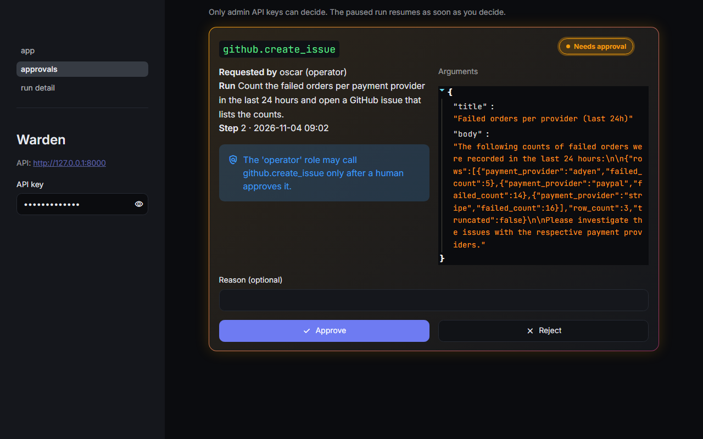
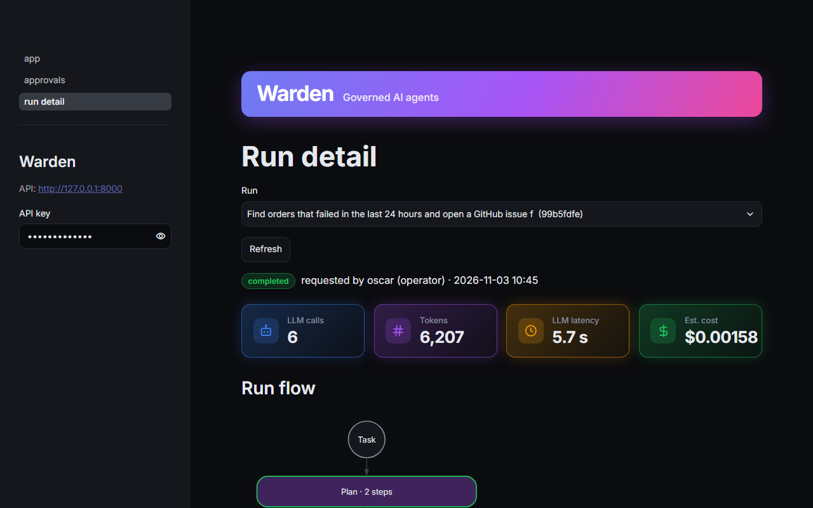
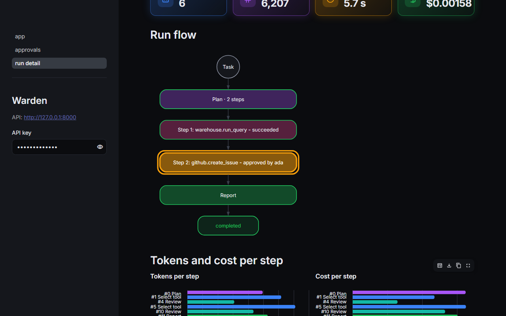
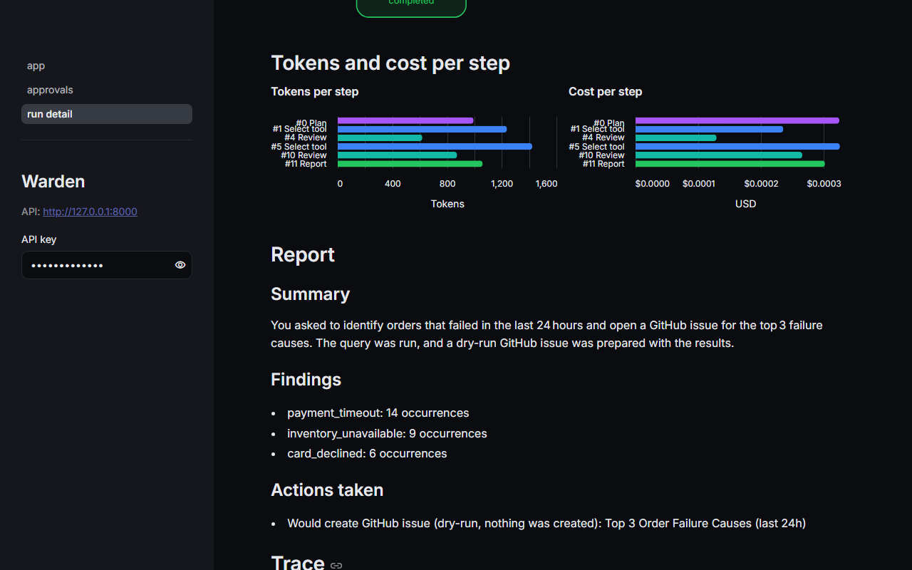
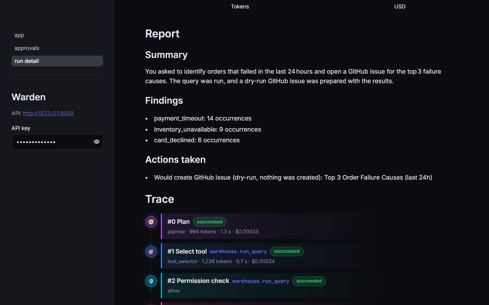
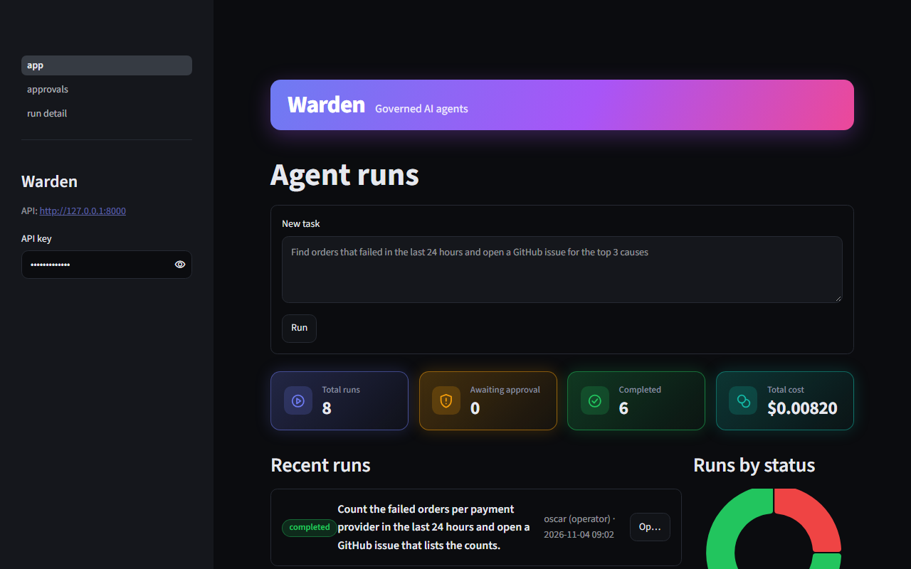
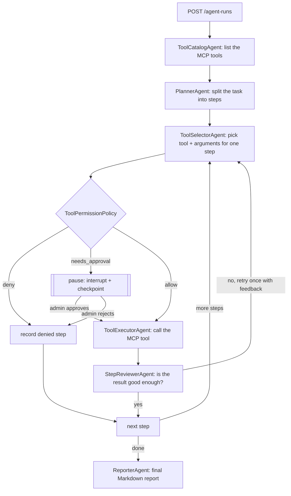
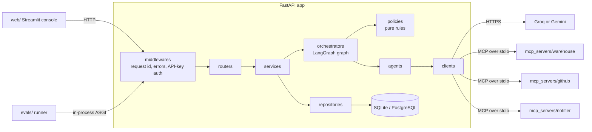

# Warden Agent Runtime

[](https://github.com/engineer-husnain21/warden-agent-runtime/actions/workflows/ci.yml)
[](https://github.com/engineer-husnain21/warden-agent-runtime/actions/workflows/evals.yml)

**A governed runtime for AI agents that take real actions.** You give Warden a task in plain
language, for example *"Find orders that failed in the last 24 hours and open a GitHub issue for
the top 3 causes"*. Warden then:

- plans the task;
- calls tools through MCP servers;
- checks every tool call against the caller's role;
- pauses for a human before risky actions;
- records every step in an append-only audit log;
- measures its own quality with a real-LLM eval suite that gates every PR.

The hard part of agents that *do* things is control, not the LLM call:

- who may trigger which action;
- what happens while a human decides;
- what survives a crash;
- how you know the agent is still right after a prompt change.

Warden is a small, complete answer to those questions.

## Contents

- [What it does](#what-it-does)
- [Console](#console)
- [How a run works](#how-a-run-works)
- [Architecture](#architecture)
- [Quickstart](#quickstart)
- [Try it with curl](#try-it-with-curl)
- [Roles and permissions](#roles-and-permissions)
- [Evals](#evals)
- [Design decisions](#design-decisions)
- [Lessons learned](#lessons-learned)
- [Configuration](#configuration)
- [Development](#development)

## What it does

| Capability | How |
|---|---|
| Task runs | `POST /api/v1/agent-runs` returns `202`; status, report, full step trace and metrics are separate endpoints |
| Tools through MCP | 3 MCP servers (`warehouse`: read-only SQL; `github`: list/create issues; `notifier`: mock outbox), each its own process, reached only through `McpToolClient` |
| Permissions | `ToolPermissionPolicy` decides `allow` / `deny` / `needs_approval` per role (`viewer`, `operator`, `admin`) and tool |
| Human-in-the-loop | Risky calls pause the run (LangGraph `interrupt()`); an admin approves or rejects; the run resumes from its checkpoint |
| Durable runs | Checkpoints after every graph node; runs left `running` by a crash resume on startup without repeating finished steps |
| Audit log | Who asked, which tool, which arguments, which decision, result, timestamp. Append-only: the repository has no update or delete |
| Observability | Tokens, LLM latency and estimated cost per step and per run, in the API and the web console |
| Evals | 31 real-LLM scenarios; CI fails when task success rate or tool-call accuracy drops below 0.8 |

The web console (Streamlit) shows runs, a live trace, the run as a flow chart, per-step
token and cost charts, and an approvals inbox.

## Console

Screenshots of real runs, with GitHub in dry-run. A full API transcript of the approval run is
in [docs/demo/demo.md](docs/demo/demo.md).

**Approvals inbox.** An operator's run paused before `github.create_issue`. The call waits for an
admin, with the policy's reason and the exact arguments (run `20eb19ba`, `gpt-oss-20b`):



**Run detail** of the headline task (run `99b5fdfe`, `gpt-oss-120b`), after an admin approved
the issue. It shows the status, LLM calls, tokens, latency and estimated cost for the whole run:



| Run flow, with the approval step | Tokens and cost per step |
|---|---|
|  |  |

| Final report and step trace | Home: recent runs and totals |
|---|---|
|  |  |

## How a run works



`ToolCatalogAgent` and `ToolExecutorAgent` use no LLM. They keep tool access inside the agent
layer, so services and the orchestrator never call a client directly
([ADR 0001](docs/adr/0001-tool-executor-agent.md); `tests/unit/test_layers.py` enforces it).
Every node emits a typed `StepEvent`. `AgentRunService` stores each one as a `RunStep` (with
tokens, latency and cost) and writes an `AuditLogEntry` for permission checks, approvals and tool
calls, as the events happen ([ADR 0003](docs/adr/0003-step-event-stream-persistence.md)).

## Architecture



Calls only go downward, and only `clients/` talk to the outside world. The MCP servers are
separate processes and never import from `app/`. The layer rules are in [CLAUDE.md](CLAUDE.md).

**Stack:**
- Python 3.12 and `uv`;
- FastAPI;
- LangGraph (interrupts and SQLite checkpoints);
- the official `mcp` SDK (FastMCP);
- SQLAlchemy 2 async with Alembic;
- pydantic-settings;
- Streamlit;
- pytest, ruff and strict mypy;
- GitHub Actions.

No Docker: everything runs with `uv run`.

## Quickstart

```powershell
uv sync
Copy-Item .env.example .env       # then set GROQ_API_KEY (or LLM_PROVIDER=gemini + GEMINI_API_KEY)
uv run alembic upgrade head        # creates warden.db
uv run python -m mcp_servers.warehouse.seed   # demo orders, timestamps relative to now
uv run uvicorn app.main:app --no-access-log   # API on http://127.0.0.1:8000 (docs at /docs)
uv run streamlit run web/app.py               # console, in a second terminal
```

The dev API keys in `.env.example` are `viewer-dev-key`, `operator-dev-key` and `admin-dev-key`.
The console starts with the admin key, and you can switch keys in its sidebar. An admin's runs
never pause, so submit a run with the operator key to see an approval.

GitHub is in **dry-run** by default (`GITHUB_MODE=dry-run`). Issues are simulated, and the
report says *"Would create GitHub issue (dry-run, nothing was created)"*. To create real issues
in a sandbox repo, set `GITHUB_MODE=live`, `GITHUB_REPO` and a fine-grained `GITHUB_TOKEN` with
Issues read/write on that repo only (see [docs/PLAN.md](docs/PLAN.md#appendix--fine-grained-github-token-for-warden-sandbox)).

## Try it with curl

```powershell
# 1. An operator submits the headline task (202 Accepted, runs in the background)
curl.exe -s -X POST http://127.0.0.1:8000/api/v1/agent-runs -H "X-API-Key: operator-dev-key" `
  -H "Content-Type: application/json" `
  -d '{\"task\":\"Find orders that failed in the last 24 hours and open a GitHub issue for the top 3 causes\"}'

# 2. Poll the status: it stops at awaiting_approval before github.create_issue
curl.exe -s http://127.0.0.1:8000/api/v1/agent-runs/<run-id> -H "X-API-Key: operator-dev-key"

# 3. An admin sees the pending approval and decides
curl.exe -s http://127.0.0.1:8000/api/v1/approvals -H "X-API-Key: admin-dev-key"   # pending only
curl.exe -s -X POST http://127.0.0.1:8000/api/v1/approvals/<approval-id>/decisions `
  -H "X-API-Key: admin-dev-key" -H "Content-Type: application/json" -d '{\"approved\":true}'

# 4. Report, step trace, metrics and audit log
curl.exe -s http://127.0.0.1:8000/api/v1/agent-runs/<run-id>/report  -H "X-API-Key: operator-dev-key"
curl.exe -s http://127.0.0.1:8000/api/v1/agent-runs/<run-id>/steps   -H "X-API-Key: operator-dev-key"
curl.exe -s http://127.0.0.1:8000/api/v1/agent-runs/<run-id>/metrics -H "X-API-Key: operator-dev-key"
curl.exe -s "http://127.0.0.1:8000/api/v1/audit-log-entries?run_id=<run-id>" -H "X-API-Key: admin-dev-key"
```

## Roles and permissions

| Role | Read tools (`warehouse.*`, `github.list_issues`, `notifier.list_outbox`) | `github.create_issue`, `notifier.send_notification` | Approve / reject |
|---|---|---|---|
| `viewer` | allow | **deny** | no |
| `operator` | allow | **needs approval** | no |
| `admin` | allow | allow | yes |

The rules live in `TOOL_PERMISSION_RULES` (config, overridable from `.env`). Any tool that no
rule matches is denied. `ToolPermissionPolicy` is pure logic with no I/O, so it is unit-tested
as a full role × tool matrix.

## Evals

```powershell
uv run python -m evals.runner --threshold 0.8          # all 31 scenarios, real LLM
uv run python -m evals.runner --tag smoke              # the 9-scenario PR subset
uv run python -m evals.runner --only github_headline_top_causes
```

Each scenario in [`evals/scenarios/`](evals/scenarios) is one YAML file with:
- a task;
- the role that asks;
- how the "human" answers approvals (`approve`, `reject` or `none`);
- what a correct run looks like.

That last part covers the tools it should pick, the tools that must or must not run, the tools
the policy must deny, and the facts the report must contain. The expected facts are computed
from `data/orders.csv`.

The runner starts the real app in-process, with its lifespan, MCP servers and checkpoints, over
httpx `ASGITransport`. Each eval gets:
- fresh temp databases;
- forced GitHub dry-run;
- API keys generated for that process only.

So an eval never touches your data, your keys or GitHub. It writes `evals/reports/latest.md` and
`latest.json`, and exits 1 when either score is below the threshold.

| Group | Scenarios | Covers |
|---|---|---|
| `warehouse_*` | 10 | SQL questions with known answers (counts, rankings, sums, schema look-up) |
| `github_*` | 6 | listing, approved and rejected issues, the headline task, labels |
| `notifier_*` | 5 | approved and rejected messages, outbox reads, query-then-notify |
| `policy_*` | 10 | viewer denials, operator approvals and rejections, admin writes without a pause |

**Scores:**
- **Task success:** every expectation of the scenario holds.
- **Tool-call accuracy:** the overlap (Jaccard) between the tools the agent picked and the
  expected tools. Schema look-ups (`list_tables`, `describe_table`) neither help nor hurt.

**Two tiers in CI** ([ADR 0004](docs/adr/0004-ci-eval-gate.md)). The full suite needs about
120–150k tokens, close to a day of the Groq free tier, so:
- every PR to `main` runs the 9 scenarios tagged `smoke`. They cover warehouse, GitHub,
  notifier, approve, reject and deny;
- the full suite runs from the workflow's **Run workflow** button and locally.

Both use the 0.8 gate. CI picks the provider and model from repository variables
(`LLM_PROVIDER`, `GROQ_MODEL`), so the gate can move to a model with quota left without a code
change.

### Results

Full suite on 2026-11-04 (`evals/reports/`, local, concurrency 2), with numbers per model:

| Run | Model | Scenarios | Task success | Tool-call accuracy | Avg tokens / run | Avg cost / run | Gate |
|---|---|---|---|---|---|---|---|
| Full suite | `openai/gpt-oss-120b` | 31 | **0.81** (25/31) | **0.76** | 3,747 | $0.00087 | failed |
| ↳ the 25 that reached the model | `openai/gpt-oss-120b` | 25 | 1.00 (25/25) | 0.94 | 4,479 | $0.00103 | — |
| Rerun of the other 6 | `openai/gpt-oss-20b` | 6 | 1.00 (6/6) | 0.94 | 5,656 | $0.00068 | passed |

How to read this:
- **The gate failed on rate limits, not on quality.** All 6 failures on 120b were Groq HTTP 429:
  the suite ran out of the model's daily token quota. Those scenarios never got an answer from
  the model, and each one scored 0 accuracy, which pulled tool-call accuracy down to 0.76.
- **The 6 passed on another model.** Groq limits are per model, so the 6 were rerun on
  `gpt-oss-20b` the same day, and all 6 passed. Every one of the 31 scenarios has a passing
  result. Because that total mixes two models, it is not quoted as one score.
- **Where tool accuracy is below 1.0**, it is always the same habit. In 4 scenarios the model
  ran an extra `warehouse.run_query` before a write whose content the task already gave. The
  run still succeeded, but the extra query cost tokens.
- **Progress:** the first full run on 2026-11-03 passed 22/31 (0.71). Lesson 3 below covers what
  the failures were and how they were fixed.
- **Cost:** a full 120b run costs about $0.03 at Groq list prices, and the headline task about
  $0.0016. Costs are estimates from per-model prices in settings.
- **Per-model behaviour differs.** The 20b demo run ([docs/demo/demo.md](docs/demo/demo.md))
  shows where the smaller model is weaker: an empty plan, and a reviewer that rejected a dry-run
  result. The 120b numbers are the reference.

## Design decisions

| ADR | Decision |
|---|---|
| [0001](docs/adr/0001-tool-executor-agent.md) | `ToolExecutorAgent` is a non-LLM agent, so tool execution stays inside the agent layer |
| [0002](docs/adr/0002-durable-runs-langgraph-checkpoints.md) | Durable runs with LangGraph `interrupt()` and checkpoints |
| [0003](docs/adr/0003-step-event-stream-persistence.md) | The orchestrator yields `StepEvent`s and the service persists them |
| [0004](docs/adr/0004-ci-eval-gate.md) | CI eval gate with a real LLM |

## Lessons learned

### 1. Unit tests with fakes could not catch a schema hallucination

The first end-to-end run of the headline task with the real LLM produced a wrong SQL query. The
task talks about failure *causes*, so the model wrote SQL against a column named `cause`. The
real column is `failure_reason`, and SQLite answered `no such column: cause`.

Every unit test was green, because the fake LLM returned the SQL the test author wrote. The bug
was in what the model *believed* about the data, not in the code.

**Fix:** the warehouse MCP server now reads the live schema at startup and puts it into the
`run_query` tool description (`- orders(order_id INTEGER, ..., failure_reason TEXT, ...)`). The
model sees the real columns before it writes SQL, and the description can never drift from the
database.

The first full eval run found the same mistake one level deeper. Asked how many orders failed
"because of a payment timeout", the model filtered on `failure_reason = 'payment timeout'`. The
stored value is `payment_timeout`, so it counted 0, and the reviewer accepted the 0. Column names
were not enough. The description now also lists the values of category-like text columns (at
most 12 distinct values), such as
`failure_reason in ('address_validation_failed', 'card_declined', ..., 'payment_timeout')`.

Two guards keep it fixed:
- eval scenarios check the facts that depend on these columns (`payment_timeout` 14 in the last
  24 hours, 21 overall);
- the PR smoke subset reruns two of them.

### 2. A prompt rule was not enough, so the report is validated in code

In dry-run mode no GitHub issue exists, so the report must not link to one. The reporter prompt
said so: "write `(dry-run, not created)` and never build a URL". On a live run the model still
wrote: "GitHub issue created (dry‑run, not created) … **#1000 – Top 3 Order Failure Causes**".
That one line had three problems:
- it said "created";
- it quoted the fake issue number;
- it used a Unicode non-breaking hyphen (U+2011), so an exact text check for `dry-run` failed.

**Fix:** keep the prompt rule, but enforce it after the model answers.
`ReporterAgent` ([`app/agents/dry_run_report.py`](app/agents/dry_run_report.py)) finds the
dry-run issues in the step results and then:
- replaces whatever the model wrote about them under "Actions taken" with one fixed line,
  `- Would create GitHub issue (dry-run, nothing was created): <title>`;
- removes any link to them;
- normalises Unicode hyphens to `-`.

Unit tests replay the model's real reply. The `github_*` eval scenarios check the wording
end-to-end, including `report_excludes: [github.com]`.

The general rule: when the output must hold for safety or correctness, use the prompt to make
it likely and code to make it certain.

### 3. The first eval run tested the evals, too

The first full run passed 22 of 31 scenarios. Of the 9 failures:
- **1 was the `payment timeout` filter above.**
- **1 was model variance:** on an email task, the planner returned an empty plan once. The same
  scenario passed on every rerun.
- **4 were a real race in the app:**
  - `POST /approvals/{id}/decisions` returned before the run left `awaiting_approval`;
  - for a moment, a run waited for an approval that no longer existed. The console showed the
    same stale state.
  - The decision now marks the run `running` before it returns.
- **3 were a bug in the eval itself:**
  - in YAML, ` #` starts a comment, so `task: Send a Slack message to #ops saying ...` reached
    the agent as "Send a Slack message to";
  - the agent then, correctly, did nothing;
  - a unit test now rejects unquoted tasks that contain ` #`.
  - The first suspect was the notifier's tool description, which never said "Slack". Running
    the planner directly on the full task showed that the description was not the cause. The
    description got clearer anyway.

Each failure was diagnosed from the JSON report, which keeps every scenario's step trace and
final report. Eval failures tell you to look, not that the model is wrong.

### 4. Demo data has to stay "recent"

The questions are about "the last 24 hours", but a seeded database ages. `data/orders.csv` stores
`hours_ago` instead of timestamps, and the seed turns it into real UTC times. The API process
starts the warehouse server, and `WAREHOUSE_SEED_ON_STARTUP=true` re-seeds it each time, so the
demo and the evals always have fresh data. Leave the flag off when you point the warehouse at
real data.

### 5. A retry can repeat a side effect, and approval does not prevent it

In the demo run on `gpt-oss-20b` ([docs/demo/demo.md](docs/demo/demo.md)):
- the reviewer rejected a successful dry-run `github.create_issue` because "the issue was not
  actually created";
- the orchestrator retried the step, and the retry paused for a second approval;
- after that approval, the call ran a second time.

The permission design held: each call needed its own approval, and the audit log shows both.
But in live mode this would have opened two real issues.

The open fix is in the orchestrator, not the prompt: retry a write tool only when the call
itself failed, never after a successful call that the reviewer disliked. Until then, an admin
who sees the same call twice should reject the second one.

### 6. Rate limits are part of the eval design

Groq's free tier counts tokens per day, per model, in a rolling window. One full suite plus the
previous day's runs used up `gpt-oss-120b`, and the last 6 scenarios failed with HTTP 429. Three
things kept that from turning into a false "the agent got worse":
- the runner records the provider error per scenario;
- the README reports numbers per model;
- CI can move to another model through a repository variable
  ([ADR 0004](docs/adr/0004-ci-eval-gate.md)).

## Configuration

All settings are environment variables (pydantic-settings, read from `.env`). Every variable is
listed with a dummy value in [`.env.example`](.env.example). The most important ones:

| Variable | Default | What it does |
|---|---|---|
| `LLM_PROVIDER` | `groq` | `groq` or `gemini`. Switching provider is a `.env` change only |
| `GROQ_API_KEY` / `GEMINI_API_KEY` | — | Key for the chosen provider |
| `GROQ_MODEL` | `openai/gpt-oss-120b` | Model; per-million-token prices are settings too, for cost estimates |
| `DATABASE_URL` | `sqlite+aiosqlite:///./warden.db` | Switch to PostgreSQL by changing only this URL |
| `API_KEYS` | dev keys | JSON map of API key → caller name and role |
| `TOOL_PERMISSION_RULES` | see above | Role → tool pattern → `allow` / `deny` / `needs_approval` |
| `MAX_STEPS` / `MAX_STEP_RETRIES` | `6` / `1` | Plan length cap; retries of a step after a failed review |
| `GITHUB_MODE` | `dry-run` | `live` creates real issues in `GITHUB_REPO` (needs `GITHUB_TOKEN`) |
| `WAREHOUSE_SEED_ON_STARTUP` | `false` | Re-seed the demo warehouse from `data/orders.csv` when the server starts |
| `EVAL_THRESHOLD` | `0.8` | Minimum task success rate and tool-call accuracy for the eval gate |

## Development

```powershell
uv run pre-commit install
uv run ruff check . ; uv run ruff format --check . ; uv run mypy ; uv run pytest -q   # the green check
```

- Unit tests (`tests/unit/`, mirroring `app/`) never touch the network. They use fake clients
  from `tests/fakes/` (`FakeLlmClient`, `FakeToolClient`) or httpx `MockTransport`.
- Integration tests (`tests/integration/`) run full flows: the API with approval, crash and
  resume, and the real MCP servers over stdio.
- CI runs the green check on Ubuntu and Windows on every push. The eval gate runs on PRs to
  `main`.
- The build plan and progress are in [docs/PLAN.md](docs/PLAN.md). The team rules are in
  [CLAUDE.md](CLAUDE.md).
