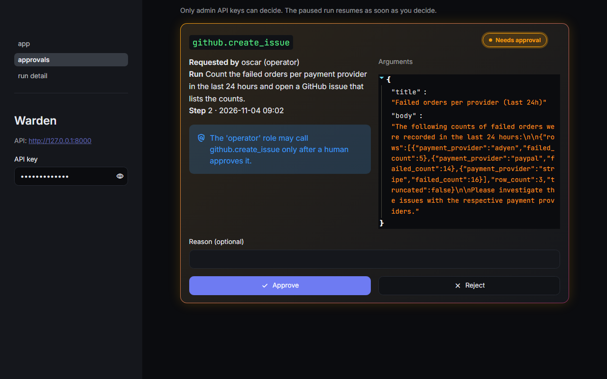

# Demo run: an approval-gated GitHub issue

A real run through the local API on 2026-11-04. The setup:
- Groq `openai/gpt-oss-20b`;
- real MCP servers;
- GitHub in dry-run.

The model was set per command (`GROQ_MODEL`), because `gpt-oss-120b` had used up its daily
quota on the eval suite ([ADR 0004](../adr/0004-ci-eval-gate.md)). Callers come from `API_KEYS`:
`oscar` is an operator and `ada` is an admin. Key values are not shown.

Run id `20eb19ba-0fd2-4bca-95ba-06ee06df0445`.

## 1. The operator submits a task

```http
POST /api/v1/agent-runs            X-API-Key: <oscar, operator>
{"task": "Count the failed orders per payment provider in the last 24 hours and open a GitHub issue that lists the counts."}

202 Accepted   {"id": "20eb19ba-…", "status": "pending", …}
```

The run plans 2 steps:
- `warehouse.run_query` is allowed for an operator and runs at once. It returns
  adyen 5, paypal 14, stripe 16.
- `github.create_issue` needs approval for an operator, so the run stops:

```http
GET /api/v1/agent-runs/20eb19ba-…  →  {"status": "awaiting_approval", …}
```

## 2. Only an admin can decide

`GET /api/v1/approvals` (admin) lists the pending call with its exact arguments. This is the
console's view of it:



```http
POST /api/v1/approvals/<id>/decisions   X-API-Key: <oscar, operator>   {"approved": true}
403 Forbidden

POST /api/v1/approvals/<id>/decisions   X-API-Key: <ada, admin>
{"approved": true, "reason": "Dry-run issue for the ops board"}
200 OK
```

## 3. A retried risky call asks again

After the approved call, the dry-run GitHub server answered with issue `#1000`. Then
`StepReviewerAgent` (20b) rejected the result: *"The issue was not actually created
(dry_run: true). Ensure the issue is created on GitHub before proceeding."*

The orchestrator retried the step once (`MAX_STEP_RETRIES=1`). The retried `create_issue` went
through the policy again and **paused for a second approval**. An approval covers one call,
never the next one. After the second approval the call ran (`#1001`, dry-run). The reviewer
rejected it again, so the step was marked failed and the run went on to the report.

## 4. Trace, metrics and report

| # | Step | Tool | Status | Tokens |
|---|---|---|---|---|
| 0 | plan | — | succeeded | 1,293 |
| 1–4 | select, permission (allow), call, review | `warehouse.run_query` | succeeded | 1,942 |
| 5–7 | select, permission (needs_approval), approval | `github.create_issue` | awaiting approval | 1,717 |
| 8–10 | approved by ada, call (#1000), review | `github.create_issue` | review **failed** | 853 |
| 11–13 | retry: select, permission, approval | `github.create_issue` | awaiting approval | 1,606 |
| 14–16 | approved by ada, call (#1001), review | `github.create_issue` | review **failed** | 853 |
| 17 | report | — | succeeded | 1,409 |

`GET /api/v1/agent-runs/20eb19ba-…/metrics`: **8 LLM calls, 9,673 tokens, 7.0 s LLM latency,
$0.00128** at 20b list prices ($0.075 / $0.30 per million tokens).

For comparison, the headline task on `gpt-oss-120b` (run `99b5fdfe`, screenshots in the README)
took 6 LLM calls, 6,207 tokens, 5.7 s and $0.00158, with one approval. Its reviewer accepted the
dry-run issue.

The final report, as `GET …/report` returned it:

> **Summary.** The user requested a count of failed orders per payment provider in the last 24
> hours and to open a GitHub issue with those counts. The query succeeded and returned the counts,
> but the issue creation was only simulated (dry-run) and was not actually posted to GitHub.
>
> **Findings.** adyen 5 · paypal 14 · stripe 16
>
> **Actions taken.** Would create GitHub issue (dry-run, nothing was created): Failed orders per
> provider (last 24h)
>
> **Not done.** The GitHub issue was not actually created because the action was performed in
> dry-run mode.

## 5. Audit log

`GET /api/v1/audit-log-entries?run_id=20eb19ba-…` (admin). The log is append-only:

| Time (UTC) | Actor | Action | Tool |
|---|---|---|---|
| 09:02:12 | oscar (operator) | run_created | — |
| 09:02:14 | oscar (operator) | tool_call_allowed | warehouse.run_query |
| 09:02:14 | oscar (operator) | tool_call_succeeded | warehouse.run_query |
| 09:02:17 | oscar (operator) | approval_requested | github.create_issue |
| 09:02:54 | ada (admin) | approval_granted | github.create_issue |
| 09:02:54 | oscar (operator) | tool_call_succeeded | github.create_issue |
| 09:02:55 | oscar (operator) | approval_requested | github.create_issue |
| 09:17:20 | ada (admin) | approval_granted | github.create_issue |
| 09:17:20 | oscar (operator) | tool_call_succeeded | github.create_issue |
| 09:17:22 | oscar (operator) | run_completed | — |

The operator's own approve attempt was refused with `403` and changed nothing. Refused decisions
are not written to the audit log, so it has no entry.

## What this run shows

- **The gate held under a retry.** Each of the two `create_issue` calls needed its own admin
  approval, and the log records both.
- **Retrying a side effect can repeat it.** In dry-run nothing was created. In live mode, the
  retry would have opened a second real issue, even though each one was approved. Follow-up: do
  not retry a write tool after its call succeeded, only after a failed call, or tell the
  reviewer that a dry-run result is a success.
- **The smaller model is weaker at judging and planning.** 20b's reviewer treated "dry-run" as
  a failure, which 120b's reviewer does not. Before this run, two 20b attempts at the headline
  task also failed in the planner: one with an empty plan (run `89968b86`, a completed run with
  no steps) and one where Groq answered HTTP 400 (run `f463dcca`; most likely its JSON-mode
validation, but the LLM client does not log the response body, so this is not confirmed). The
  120b eval numbers in the README are the reference; 20b covered a quota gap.
